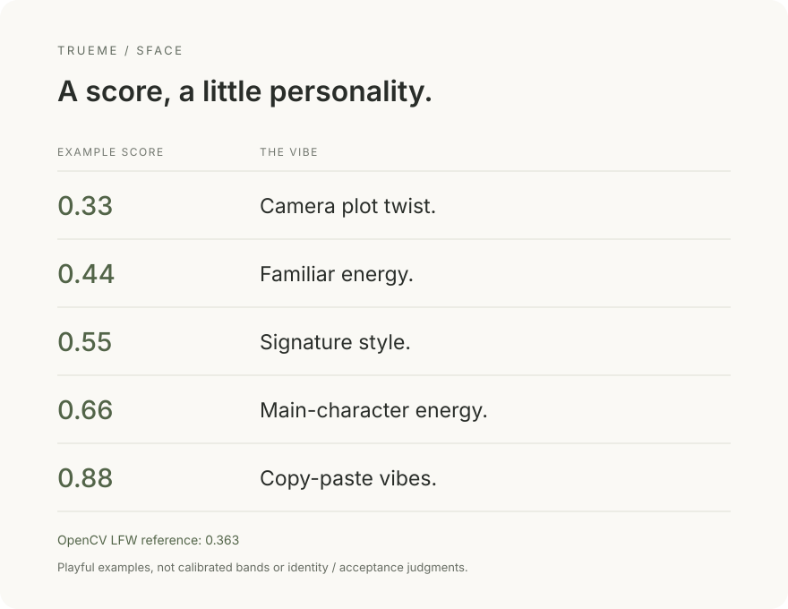

<h1 align="center">TrueMe</h1>

<p align="center">Compare a reference photo and a probe photo locally with a Python CLI.</p>

<p align="center">
  <a href="pyproject.toml"></a>
  <a href="LICENSE"></a>
</p>

<p align="center">
  <a href="#quick-start">Quick Start</a> ·
  <a href="#usage">Usage</a> ·
  <a href="#documentation">Documentation</a> ·
  <a href="CONTRIBUTING.md">Contributing</a>
</p>

<p align="center">
  
</p>

TrueMe uses YuNet to detect and align faces, then SFace to compare their features.
Use your own photos or photos used with explicit consent. Scores describe
similarity under this model; they are not confidence percentages, identity
verdicts, or predictions of third-party verification acceptance.

## Features

- **One pair, one score.** Compare an enrollment/reference photo with a probe
  representing camera conditions; require exactly one face in each image.
- **Local processing.** No uploads, telemetry, accounts, or automatic history.
  Inputs remain unchanged; crops and embeddings stay in memory.
- **Photo handling.** JPEG, PNG, and WebP, Unicode paths, EXIF orientation, and
  heuristic warnings for small faces, blur, and extreme exposure.
- **Explicit device control.** CPU or CUDA, with observable automatic CPU fallback
  and strict failure when explicitly requested CUDA cannot run.
- **Scriptable results.** Structured JSON, stable exit codes, environment
  diagnostics, and optional reports protected against overwriting input images.

## Quick Start

The recommended first run uses **CPU**. Install 64-bit **Python 3.11**, Git, and
**GNU Make**, then use PowerShell below. For macOS/Linux shell setup, follow the
[installation guide](docs/installation.md#linux-and-macos); macOS uses CPU.
Other Python minor versions are currently excluded by the package requirements.

```powershell
git clone https://github.com/ZhiWei-Ou/trueme.git
cd trueme
make setup PYTHON="py -3.11" DEVICE=cpu
```

Setup installs dependencies in the project's `.venv`; activation is unnecessary.
Download the two pinned models explicitly (weights are not included in Git):

```powershell
New-Item -ItemType Directory -Force models | Out-Null
$revision = "48b10fa505aeb51fbd127fc60a5c660040e823b7"
$base = "https://media.githubusercontent.com/media/opencv/opencv_zoo/$revision/models"
Invoke-WebRequest "$base/face_detection_yunet/face_detection_yunet_2023mar.onnx" -OutFile "models/face_detection_yunet_2023mar.onnx"
Invoke-WebRequest "$base/face_recognition_sface/face_recognition_sface_2021dec.onnx" -OutFile "models/face_recognition_sface_2021dec.onnx"
.\.venv\Scripts\trueme.exe doctor --model-dir models
```

Model sources, licenses, and publisher checksums are in the [model guide](docs/models.md).
TrueMe verifies both hashes before initialization. In a CPU installation,
`doctor` reporting unavailable CUDA is expected; CPU initialization should succeed.

Place two consented, single-frame photos in the project root as `reference.jpg`
and `probe.jpg`, each containing exactly one face. Then compare:

```powershell
.\.venv\Scripts\trueme.exe compare --reference reference.jpg --probe probe.jpg --model-dir models --device cpu
```

The result includes cosine similarity, model names, configured providers, any
quality warnings, and an interpretation notice. A higher score means greater
feature similarity under SFace; there is no universal pass/fail threshold.
On macOS/Linux, the executable is `.venv/bin/trueme`; `python -m trueme` also works
when invoked with the virtual environment's Python.

## Usage

### Inspect the installation

```powershell
.\.venv\Scripts\trueme.exe --help
.\.venv\Scripts\trueme.exe --version
.\.venv\Scripts\trueme.exe models list --json
.\.venv\Scripts\trueme.exe doctor --model-dir models --json
```

Help, version, and basic diagnostics work without weights. `doctor` distinguishes
provider enumeration and session initialization from actual inference. Use
`compare` to exercise inference; `--verbose` adds device diagnostics to stderr.

### Export a report

```powershell
.\.venv\Scripts\trueme.exe compare --reference reference.jpg --probe probe.jpg --model-dir models --json --output result.report.json
```

`--json` writes one JSON object to stdout, including errors; diagnostics go to
stderr. `--output` explicitly saves a report. Existing reports require
`--overwrite`; input images and their aliases cannot be replaced. The parent
directory must exist. Filenames and scores in reports may still be sensitive.

<details>
<summary>JSON schema and exit codes</summary>

Success reports use schema `1.0` and include `schema_version`, a timezone-aware
`timestamp`, `application_version`, model names/versions/hashes, requested device,
configured providers and fallback details, reference/probe basenames,
`cosine_similarity`, `quality_warnings`, and `interpretation`.
Images, embeddings, and full input paths are excluded. NaN and infinity are rejected.
Errors contain `error.type`, `error.message`, and `error.exit_code`.

| Code | Meaning |
| --- | --- |
| 0 | Completed; doctor may still report unavailable capabilities |
| 2 | Invalid input or command usage |
| 3 | Missing, invalid, or incompatible model |
| 4 | Device initialization or execution failure |
| 5 | Face processing or invalid model output |
| 6 | Unsafe or unwritable report destination |

</details>

<a id="a-score-with-a-little-personality"></a>

<details>
<summary>What the score illustration is based on</summary>

The [OpenCV 4.12 SFace tutorial](https://docs.opencv.org/4.12.0/d0/dd4/tutorial_dnn_face.html)
reports a cosine threshold of **0.363** for LFW. The
[OpenCV Zoo demo at our pinned revision](https://github.com/opencv/opencv_zoo/blob/48b10fa505aeb51fbd127fc60a5c660040e823b7/models/face_recognition_sface/sface.py)
uses the same value. The illustration gives a rough interpretation of a score
relative to that reference:

| Cosine score | Rough evaluation |
| --- | --- |
| Below 0.363 | Below the reference — camera, let's get acquainted again. |
| At least 0.363 | Meets the reference — that familiar feeling is back. |

"Meets the reference" means reaching the published SFace/LFW threshold, not a
calibrated TrueMe acceptance decision. Higher values mean greater feature
similarity under this model, not confidence percentages. The playful captions
add no measured meaning. This guide does not establish identity, predict door
access or attendance acceptance, or certify ID-photo compliance. TrueMe's CLI
continues to report raw cosine similarity without applying a pass/fail threshold.

</details>

### Input limits and common errors

Run each reference/probe pair independently. Batch processing and live capture
are outside this MVP. Animated and multi-frame files, including MPO containers
with `.jpg` extensions, are rejected; explicitly export the intended single frame.
No/multiple-face errors require an input containing exactly one visible face.
Quality warnings are heuristics; lighting, pose, and alignment can affect scores.

For missing weights, follow the model guide and check the model directory.
For CUDA failures, check the GPU setup or select CPU. Report errors require a
writable destination distinct from the inputs. The CLI offers no identity search,
surveillance, liveness checks, or identity verification, and does not promise
secure memory erasure.

## Configuration

| Setting | Purpose | Default |
| --- | --- | --- |
| `--model-dir` | Directory containing both model files | Environment variable, then per-user storage |
| `TRUEME_MODEL_DIR` | Model directory when the option is omitted | Unset |
| `--device auto\|cpu\|cuda` | Select inference device | `auto` |
| `--output` | Explicit JSON report destination | No file written |
| `--overwrite` | Allow replacement of an existing report | Off |

Model lookup uses `--model-dir` → `TRUEME_MODEL_DIR` → the
[platform's per-user directory](docs/installation.md#model-storage). It does not
automatically search the project's `models/` directory.

`auto` attempts CUDA and reports CPU fallback on unavailability, initialization
failure, or execution failure. `cuda` fails instead of silently using a CPU-only
session; `cpu` forces CPU. Configured providers do not prove every operation ran
on GPU. CPU and GPU environments must never contain both `onnxruntime` and
`onnxruntime-gpu`; see [GPU setup](docs/installation.md#cpu-and-nvidia-cuda-environments).

## Documentation

| Guide | Use it for |
| --- | --- |
| [Installation](docs/installation.md) | Windows, macOS/Linux, CPU/GPU setup, model directories |
| [Models](docs/models.md) | Acquisition, licenses, checksums, preprocessing, device behavior |
| [Architecture](docs/architecture.md) | Module responsibilities and platform boundaries |
| [Validation](docs/validation.md) | Actual CPU/CUDA checks and human acceptance steps |
| [Security](SECURITY.md) | Privacy and vulnerability reporting guidance |

Windows is the primary target; Linux, macOS, and Windows CI jobs are configured.
Recorded local runtime validation covers Linux CPU and CUDA. Native Windows/macOS
and hosted CI execution are not established by that validation record.

## Contributing

Read [CONTRIBUTING.md](CONTRIBUTING.md) for scope, implementation conventions,
and privacy requirements. After setup, run:

```sh
make test
make lint
make build
```

Use `gmake` where GNU Make has that name. These targets do not download weights
or process personal photos. Keep photos, weights, reports, and environments out
of commits. Builds produce a wheel and source archive under `dist/`.

## License

Original code is licensed under [MIT](LICENSE). Dependencies and model weights
retain separate licenses and notices; consult the [model licenses](docs/models.md#sources-and-licenses)
before using or redistributing weights.
